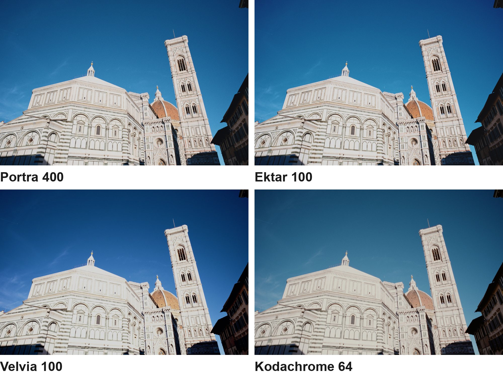
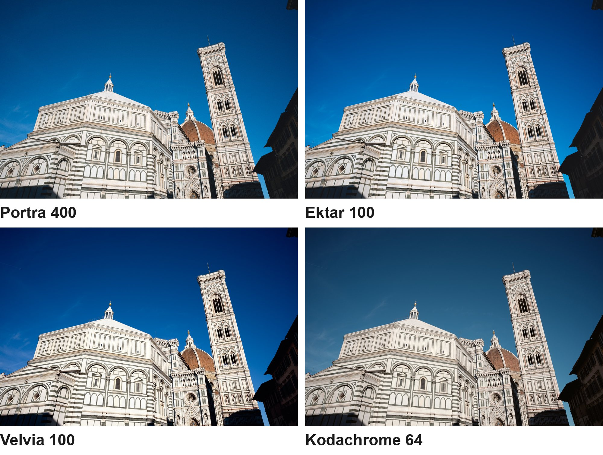
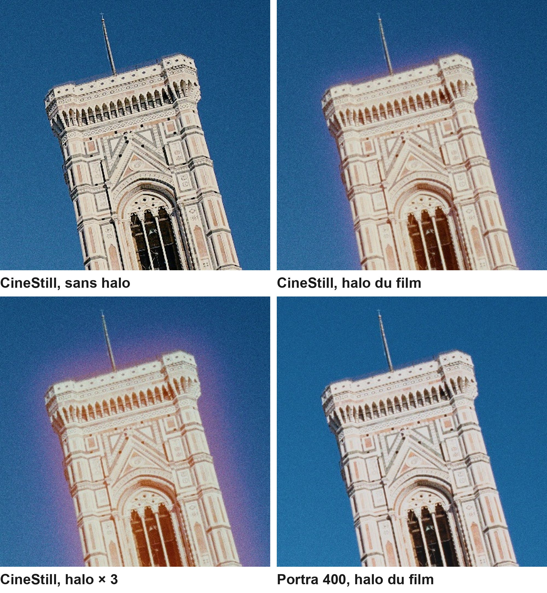

**English** | [Français](README.fr.md)

# SpektraLR

Film emulation for Lightroom Classic: the look of analog film stocks in Lightroom, as 20 creative profiles and their presets, computed with the spectral film simulation of [spektrafilm](https://github.com/andreavolpato/spektrafilm). And a Mac plug-in that sends my RAW files to [SpektraLab](https://github.com/JamesQiu2005/SpektraLab) and gives me back a real print, halation and grain included.

## Download

| Pack | What it contains |
|---|---|
| **[SpektraLR.zip](https://github.com/ThomasHMD/SpektraLR/releases/latest/download/SpektraLR.zip)** | the 20 profiles and the 20 presets (Mac and Windows), the Lightroom plug-in (Mac) and the licenses |

All versions are in the [Releases](https://github.com/ThomasHMD/SpektraLR/releases).

## Profiles or plug-in?

| | The profiles and presets | The SpektraLR plug-in |
|---|---|---|
| Where | in the Develop module, live, with the Amount slider | Library ▸ Plug-in Extras ▸ SpektraLR…: a 16-bit TIFF comes back, stacked on the RAW |
| Look | the color and tones of the film printed on its paper | the full print, computed photo by photo: film, paper, halation, grain at the scale of the negative |
| Films | 20 | 25: the same ones, plus Tri-X 400, HP5 Plus, T-Max 100, Acros II and CineStill 800T |
| Grain | Lightroom's own, set according to the film speed | the film's own, at the size of the negative (135, 120…) |
| Halation | no | yes, adjustable from 0 to 4 times the film's own |
| You need | Lightroom Classic or Camera Raw, Mac or Windows | a Mac with [SpektraLab](https://spektralab.app) 1.3.4 or later |
| Time | instant | about 8 s per 26 Mpx photo |

## Getting started

### The profiles and presets

1. From the pack, copy the `Presets Lightroom/SpektraLR` folder into the Camera Raw settings folder:
   - Mac: `~/Library/Application Support/Adobe/CameraRaw/Settings/`
   - Windows: `C:\Users\<your-name>\AppData\Roaming\Adobe\CameraRaw\Settings\`

   If "Store presets with this catalog" is ticked in Lightroom, copy it into the `Lightroom Settings/Settings/` folder next to the catalog instead (`Paramètres Lightroom/Settings/` on a French install).
2. Restart Lightroom.
3. Profiles: Basic panel ▸ Profile ▸ Browse ▸ the **SpektraLR** group. Presets (the profile plus a grain): Presets panel ▸ **SpektraLR**.

The profiles are made for RAW files: they start from the Adobe Standard look, which they impose. They do not show up for a JPEG. A gray that Lightroom renders at 50% comes out as the gray of the print. The Amount slider goes from 0% (Adobe Standard) to 200%.

Do not use "Import Profiles & Presets": Lightroom then files them in a folder specific to the machine.

### The plug-in (Mac)

1. Install [SpektraLab](https://spektralab.app). In SpektraLab ▸ Settings ▸ Agents, enable access, then click "Install": the `spektralab` command is placed in `~/.local/bin/`.
2. In Lightroom ▸ File ▸ Plug-in Manager ▸ Add, choose `SpektraLR.lrplugin`.
3. Select some RAW files, then Library ▸ Plug-in Extras ▸ **SpektraLR…** Choose the film, the paper (by default the one the film recommends), the negative format, the halation and the grain, then the export preset (by default the 16-bit TIFF in ProPhoto).

The print is written next to the RAW, named `<photo>_<film>_<paper>.tif`, and lands in the catalog, stacked above the original. The plug-in takes over Lightroom's exposure and white balance. Cropping and local adjustments are done afterwards on the TIFF: cropping after the fact is what the enlarger does, and the grain keeps the size of the whole negative.

## The films

Negatives printed on the paper each one recommends (Kodak Portra Endura, Fujifilm Crystal Archive II, Kodak Vision 2383):
Portra 160, 400, 800 and 800 pushed one and two stops, Ektar 100, Gold 200, UltraMax 400, Fujifilm C200, Pro 400H, X-Tra 400, and the Kodak cinema films Vision3 50D, 200T, 250D, 500T and Verita 200D.

Slides, scanned: Fujifilm Provia 100F, Velvia 100, Kodak Ektachrome E100, Kodachrome 64.

With the plug-in only: Kodak Tri-X 400, T-Max 100, Ilford HP5 Plus 400, Fujifilm Acros II, CineStill 800T.

## Examples

### The profiles, exported by Lightroom

The presets on virtual copies of RAW files from my X-T4, reset to the default Adobe Standard look, with no other adjustment.

| Plate | What you see |
|---|---|
| [Florence](docs/figures/spektralr-planche-profils-florence.jpg), [the car](docs/figures/spektralr-planche-profils-voiture.jpg), [the sea](docs/figures/spektralr-planche-profils-mer.jpg), [the flowers](docs/figures/spektralr-planche-profils-fleurs.jpg), [the waterfall](docs/figures/spektralr-planche-profils-cascade.jpg) | Portra 400, Ektar 100, Velvia 100 and Kodachrome 64 |
| [The color negatives](docs/figures/spektralr-planche-profils-negatifs.jpg) | Portra 400, Pro 400H, Gold 200 and Provia 100F |
| [The cinema films](docs/figures/spektralr-planche-profils-cinema.jpg) | Vision3 500T and Vision3 250D |

### The plug-in

The plug-in's renderings, on the same RAW files, with no other adjustment.

| Plate | What you see |
|---|---|
| [Florence](docs/figures/spektralr-planche-exemples-florence.jpg), [the car](docs/figures/spektralr-planche-exemples-voiture.jpg), [the sea](docs/figures/spektralr-planche-exemples-mer.jpg), [the flowers](docs/figures/spektralr-planche-exemples-fleurs.jpg), [the waterfall](docs/figures/spektralr-planche-exemples-cascade.jpg) | Portra 400, Ektar 100, Velvia 100 and Kodachrome 64 on the same photo |
| [The color negatives](docs/figures/spektralr-planche-portraits-de-films.jpg) | Portra 400, Pro 400H, Gold 200 and Provia 100F |
| [The cinema films](docs/figures/spektralr-planche-cinema.jpg) | Vision3 500T and CineStill 800T, the CineStill without its anti-halation layer |
| [Black and white](docs/figures/spektralr-planche-noir-et-blanc.jpg) | Tri-X 400 and HP5 Plus, printed on Ilford Multigrade |
| [Halation](docs/figures/spektralr-planche-halo.jpg) | the top of the campanile, without halation, with the film's halation, with triple halation |

## How it is made

[How the profiles are made](docs/fabrication-des-profils.md) (in French) explains what Lightroom gives a creative profile, how the table undoes the Adobe Standard curve before passing the scene through spektrafilm, and how each file is checked. In the real Lightroom, the rendering of a profile matches the computed table: mean ΔE of 0.16 on Portra 400, 0.30 on Velvia 100.

## The repository

| Folder | Contents |
|---|---|
| [`SpektraLR.lrplugin/`](SpektraLR.lrplugin/) | the Lightroom plug-in (Lua) |
| [`presets/SpektraLR/`](presets/SpektraLR/) | the profiles, the presets, their licenses and their `CHANGELOG.txt` |
| [`outils/`](outils/) | the profile computation (`fabriquer_profils.py`, with spektrafilm) and the writing of the tables in Adobe's format (`adobe_table.py`) |
| [`outils/essai-lr/`](outils/essai-lr/) | a test plug-in that drives Lightroom through files (virtual copies, presets, exports), and the comparison between Lightroom and the table |
| [`tests/`](tests/) | the checks: `lua tests/test_hors_lr.lua`, `lua tests/test_avec_cli.lua <copy of a RAW>` (the whole plug-in, with the real SpektraLab command), `python3 tests/test_profils.py` |
| [`docs/`](docs/) | the profile fabrication write-up, the plates |

To rebuild the profiles: install spektrafilm (0.3.4), get `dng_render.cpp` from Adobe's [DNG SDK](https://helpx.adobe.com/camera-raw/desktop/dng-and-file-formats/digital-negative.html), then run `python outils/fabriquer_profils.py --dng-render dng_render.cpp --sortie <folder>`.

## Licenses and credits

- **The plug-in and the tools**: GPL-3.0 ([`LICENSE`](LICENSE)).
- **The profiles**: film modeling powered by spektrafilm. They are derived from [spektrafilm](https://github.com/andreavolpato/spektrafilm) by Andrea Volpato, under the CC BY-SA 4.0 license, and modified by me. What I changed is in [`CHANGELOG.txt`](presets/SpektraLR/CHANGELOG.txt). They remain under CC BY-SA 4.0: you can share and modify them, keeping these credits and this license.
- **SpektraLab**, by Hanze Qiu (GPL-3.0), is not included: the plug-in calls its command.
- **The photos** (the plates in `docs/figures/` and the preview image): © Thomas Hammoudi, all rights reserved. They are under none of the licenses above, which cover the code, the profiles, the documentation and the analyses.

Details: [`LICENCES-TIERS.md`](LICENCES-TIERS.md). SpektraLR is a personal project, with no official link to spektrafilm, SpektraLab or Adobe. Lightroom and Camera Raw are trademarks of Adobe.
