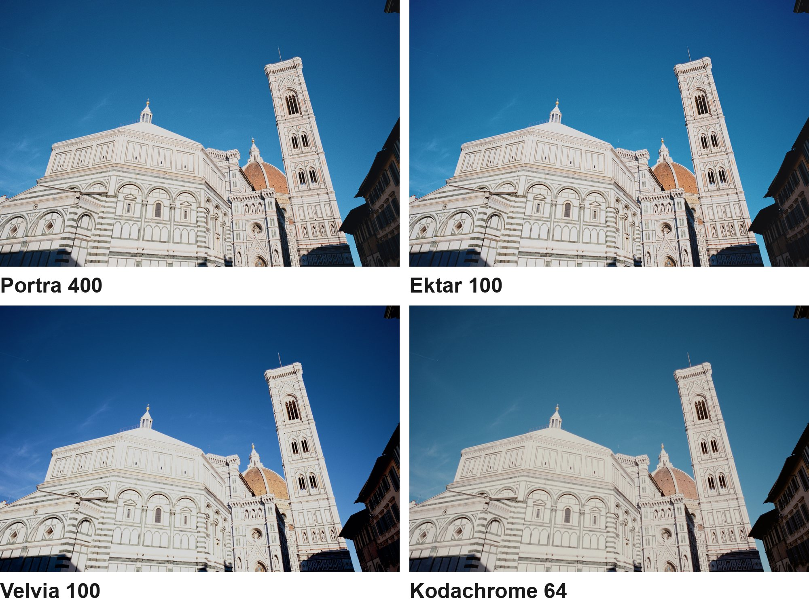
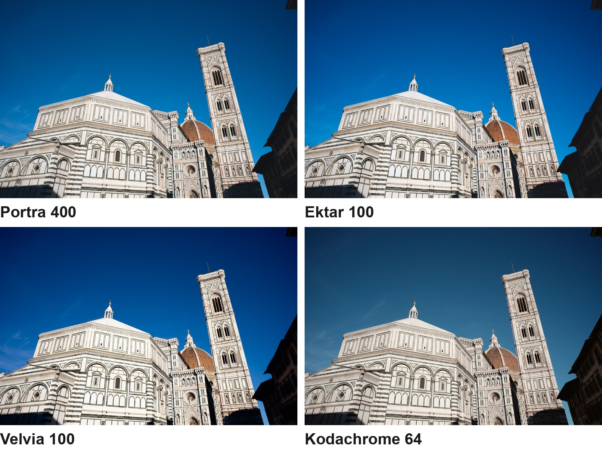
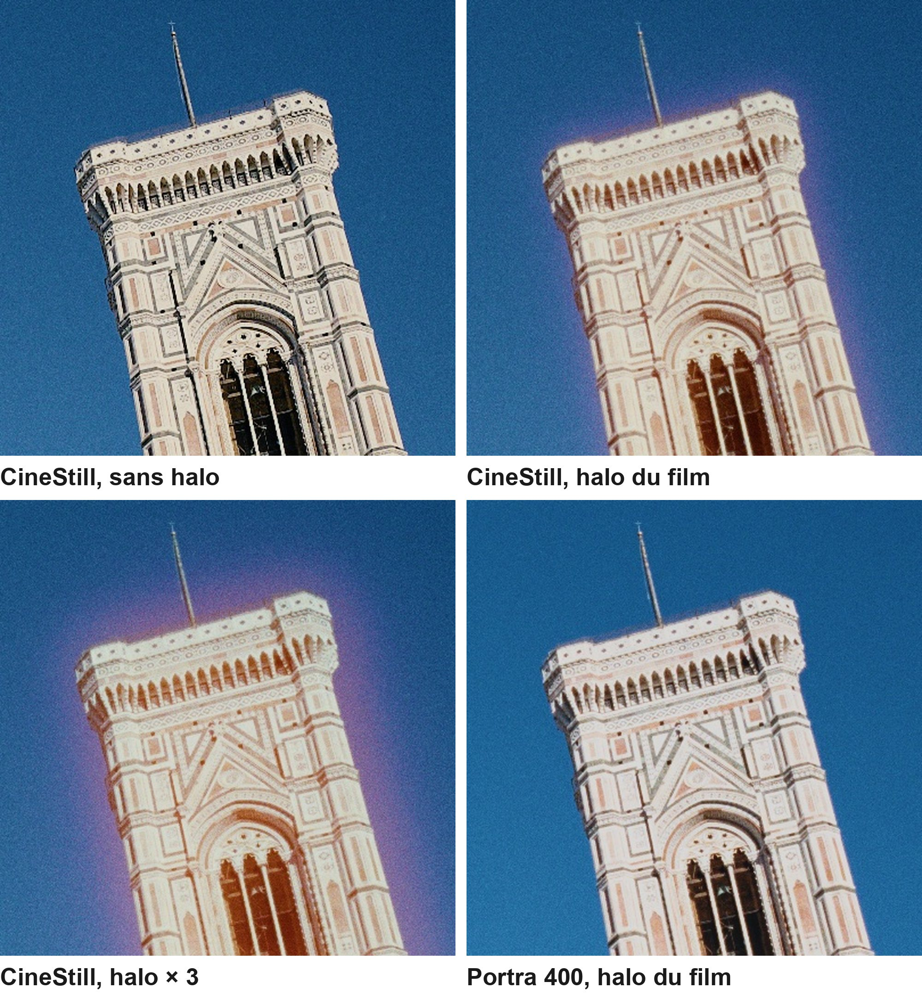

# SpektraLR

Le rendu des films argentiques dans Lightroom Classic. 20 profils créatifs et leurs presets, calculés avec la simulation spectrale de [spektrafilm](https://github.com/andreavolpato/spektrafilm). Et un module, pour Mac, qui envoie mes RAW à [SpektraLab](https://github.com/JamesQiu2005/SpektraLab) et me rend un vrai tirage, halo et grain compris.

## Télécharger

| Pack | Ce qu'il contient |
|---|---|
| **[SpektraLR.zip](https://github.com/ThomasHMD/SpektraLR/releases/latest/download/SpektraLR.zip)** | les 20 profils et les 20 presets (Mac et Windows), le module Lightroom (Mac) et les licences |

Toutes les versions sont dans les [Releases](https://github.com/ThomasHMD/SpektraLR/releases).

## Profils ou module ?

| | Les profils et presets | Le module SpektraLR |
|---|---|---|
| Où | dans Développement, en direct, avec le curseur Quantité | Bibliothèque ▸ Modules externes ▸ SpektraLR… : un TIFF 16 bits revient, empilé sur le RAW |
| Rendu | la couleur et les tons du film tiré sur son papier | le tirage complet, calculé photo par photo : film, papier, halo, grain à l'échelle du négatif |
| Films | 20 | 25 : les mêmes, plus Tri-X 400, HP5 Plus, T-Max 100, Acros II et CineStill 800T |
| Grain | celui de Lightroom, réglé selon la sensibilité du film | celui du film, à la taille du négatif (135, 120…) |
| Halo | non | oui, réglable de 0 à 4 fois celui du film |
| Il faut | Lightroom Classic ou Camera Raw, Mac ou Windows | un Mac avec [SpektraLab](https://spektralab.app) 1.3.4 ou plus |
| Temps | instantané | environ 8 s par photo de 26 Mpx |

## Démarrer

### Les profils et les presets

1. Dans le pack, copiez le dossier `Presets Lightroom/SpektraLR` dans le dossier des réglages de Camera Raw :
   - Mac : `~/Library/Application Support/Adobe/CameraRaw/Settings/`
   - Windows : `C:\Users\<votre-nom>\AppData\Roaming\Adobe\CameraRaw\Settings\`

   Si l'option « Stocker les paramètres prédéfinis avec ce catalogue » est cochée dans Lightroom, copiez-le plutôt dans `Paramètres Lightroom/Settings/`, à côté du catalogue.
2. Relancez Lightroom.
3. Profils : panneau Réglages de base ▸ Profil ▸ Parcourir ▸ groupe **SpektraLR**. Presets (le profil plus un grain) : panneau Paramètres prédéfinis ▸ **SpektraLR**.

Les profils sont faits pour les RAW : ils partent du rendu Adobe Standard, qu'ils imposent. Ils ne s'affichent pas pour un JPEG. Un gris que Lightroom rend à 50 % sort au gris du tirage. Le curseur Quantité va de 0 % (Adobe Standard) à 200 %.

N'utilisez pas « Importer des profils et des paramètres prédéfinis » : Lightroom les range alors dans un dossier propre à la machine.

### Le module (Mac)

1. Installez [SpektraLab](https://spektralab.app). Dans SpektraLab ▸ Réglages ▸ Agents, activez l'accès, puis cliquez sur « Installer » : la commande `spektralab` est posée dans `~/.local/bin/`.
2. Dans Lightroom ▸ Fichier ▸ Gestionnaire de modules externes ▸ Ajouter, choisissez `SpektraLR.lrplugin`.
3. Sélectionnez des RAW, puis Bibliothèque ▸ Modules externes ▸ **SpektraLR…** Choisissez le film, le papier (par défaut celui que conseille le film), le format du négatif, le halo et le grain, puis la recette d'export (par défaut « TIFF 16-bit — ProPhoto »).

Le tirage sort à côté du RAW, nommé `<photo>_<film>_<papier>.tif`, et arrive dans le catalogue, empilé au-dessus de l'original. Le module reprend l'exposition et la balance des blancs de Lightroom. Le recadrage et les retouches locales se font ensuite sur le TIFF : recadrer après coup, c'est ce que fait l'agrandisseur, et le grain garde la taille du négatif entier.

## Les films

Négatifs tirés sur le papier que conseille chacun (Kodak Portra Endura, Fujifilm Crystal Archive II, Kodak Vision 2383) :
Portra 160, 400, 800 et 800 poussé d'un et de deux diaphs, Ektar 100, Gold 200, UltraMax 400, Fujifilm C200, Pro 400H, X-Tra 400, et les films cinéma Kodak Vision3 50D, 200T, 250D, 500T et Verita 200D.

Diapositives, scannées : Fujifilm Provia 100F, Velvia 100, Kodak Ektachrome E100, Kodachrome 64.

Avec le module seulement : Kodak Tri-X 400, T-Max 100, Ilford HP5 Plus 400, Fujifilm Acros II, CineStill 800T.

## Exemples

### Les profils, exportés par Lightroom

Les presets sur des copies virtuelles de RAW de mon X-T4, remises au rendu par défaut d'Adobe Standard, sans autre retouche.

| Planche | Ce qu'on y voit |
|---|---|
| [Florence](docs/figures/spektralr-planche-profils-florence.jpg), [la voiture](docs/figures/spektralr-planche-profils-voiture.jpg), [la mer](docs/figures/spektralr-planche-profils-mer.jpg), [les fleurs](docs/figures/spektralr-planche-profils-fleurs.jpg), [la cascade](docs/figures/spektralr-planche-profils-cascade.jpg) | Portra 400, Ektar 100, Velvia 100 et Kodachrome 64 |
| [Les négatifs couleur](docs/figures/spektralr-planche-profils-negatifs.jpg) | Portra 400, Pro 400H, Gold 200 et Provia 100F |
| [Le cinéma](docs/figures/spektralr-planche-profils-cinema.jpg) | Vision3 500T et Vision3 250D |

### Le module

Les rendus du module, sur les mêmes RAW, sans autre retouche.

| Planche | Ce qu'on y voit |
|---|---|
| [Florence](docs/figures/spektralr-planche-exemples-florence.jpg), [la voiture](docs/figures/spektralr-planche-exemples-voiture.jpg), [la mer](docs/figures/spektralr-planche-exemples-mer.jpg), [les fleurs](docs/figures/spektralr-planche-exemples-fleurs.jpg), [la cascade](docs/figures/spektralr-planche-exemples-cascade.jpg) | Portra 400, Ektar 100, Velvia 100 et Kodachrome 64 sur la même photo |
| [Les négatifs couleur](docs/figures/spektralr-planche-portraits-de-films.jpg) | Portra 400, Pro 400H, Gold 200 et Provia 100F |
| [Le cinéma](docs/figures/spektralr-planche-cinema.jpg) | Vision3 500T et CineStill 800T, la CineStill sans couche anti-halo |
| [Le noir et blanc](docs/figures/spektralr-planche-noir-et-blanc.jpg) | Tri-X 400 et HP5 Plus, tirés sur Ilford Multigrade |
| [Le halo](docs/figures/spektralr-planche-halo.jpg) | le haut du campanile, sans halo, avec le halo du film, avec un halo triplé |

## Comment c'est fait

[La fabrication des profils](docs/fabrication-des-profils.md) explique ce que Lightroom donne à un profil créatif, comment la table défait la courbe d'Adobe Standard avant de passer la scène dans spektrafilm, et comment chaque fichier est contrôlé. Dans le vrai Lightroom, le rendu d'un profil colle à la table calculée : écart moyen ΔE 0,16 sur la Portra 400, 0,30 sur la Velvia 100.

## Le dépôt

| Dossier | Contenu |
|---|---|
| [`SpektraLR.lrplugin/`](SpektraLR.lrplugin/) | le module Lightroom (Lua) |
| [`presets/SpektraLR/`](presets/SpektraLR/) | les profils, les presets, leurs licences et leur `CHANGELOG.txt` |
| [`outils/`](outils/) | le calcul des profils (`fabriquer_profils.py`, avec spektrafilm) et l'écriture des tables au format d'Adobe (`adobe_table.py`) |
| [`outils/essai-lr/`](outils/essai-lr/) | un module d'essai qui pilote Lightroom par fichiers (copies virtuelles, presets, exports), et la comparaison entre Lightroom et la table |
| [`tests/`](tests/) | les contrôles : `lua tests/test_hors_lr.lua`, `lua tests/test_avec_cli.lua <copie d'un RAW>` (le module entier, avec la vraie commande SpektraLab), `python3 tests/test_profils.py` |
| [`docs/`](docs/) | la fabrication des profils, les planches |

Refaire les profils : installez spektrafilm (0.3.4), récupérez `dng_render.cpp` du [DNG SDK d'Adobe](https://helpx.adobe.com/camera-raw/desktop/dng-and-file-formats/digital-negative.html), puis `python outils/fabriquer_profils.py --dng-render dng_render.cpp --sortie <dossier>`.

## Licences et crédits

- **Le module et les outils** : GPL-3.0 ([`LICENSE`](LICENSE)).
- **Les profils** : film modeling powered by spektrafilm. Ils sont dérivés de [spektrafilm](https://github.com/andreavolpato/spektrafilm) d'Andrea Volpato, sous licence CC BY-SA 4.0, et modifiés par moi. Ce que j'ai changé est dans [`CHANGELOG.txt`](presets/SpektraLR/CHANGELOG.txt). Ils restent sous CC BY-SA 4.0 : vous pouvez les partager et les modifier, en gardant ces crédits et cette licence.
- **SpektraLab**, de Hanze Qiu (GPL-3.0), n'est pas inclus : le module appelle sa commande.

Détail : [`LICENCES-TIERS.md`](LICENCES-TIERS.md). SpektraLR est un projet personnel, sans lien officiel avec spektrafilm, SpektraLab ou Adobe. Lightroom et Camera Raw sont des marques d'Adobe.
